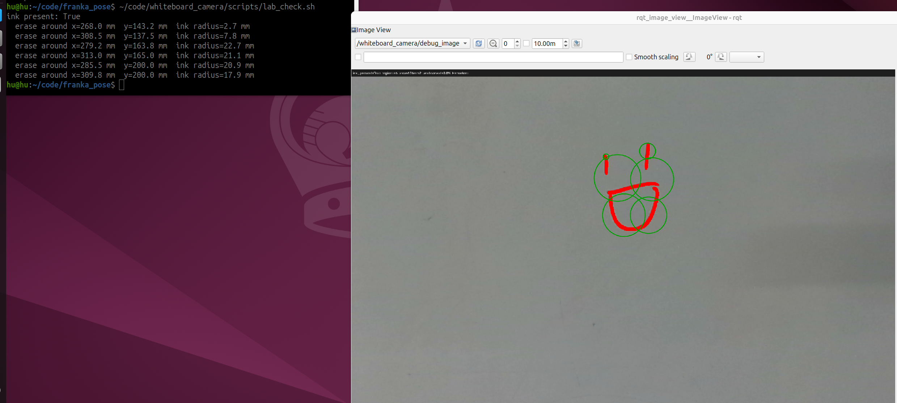
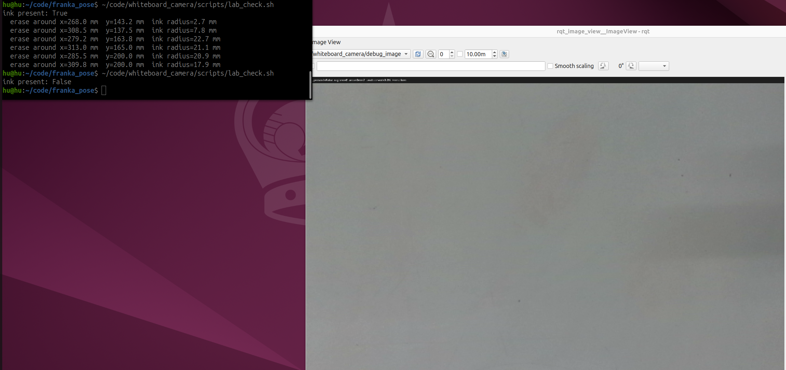

# Whiteboard Camera Module

Camera part of the group project "Franka Research 3 (FR3) draws and erases on a whiteboard".
The module looks at the whiteboard and reports whether ink is left and where,
so the erase routine can check its result and erase again only where needed.

**Status (2026-11-23):** working on the real setup (FR3, RealSense D435 at the
gripper, whiteboard flat on the table). At the photo pose the module reports
correctly whether there is ink on the board: clean board -> no ink, a drawing
-> ink with its regions, after wiping -> no ink again. See
[Running it in the lab](#running-it-in-the-lab). Still open: other pen colours,
smeared boards, threshold tuning, the link to the robot's coordinate frame and
erasing by the robot; see [Lab checklist](#lab-checklist).

## What it delivers

| Output | Type | Meaning |
|---|---|---|
| ink present | bool | Ink was found in the drawing area |
| ink regions | list of `(x, y, r)` | Circles that together cover all ink. Millimetres in the whiteboard frame. `r` is the radius of the ink itself, without the eraser width |
| unobserved fraction | float | Share of the drawing area that could not be checked (glare, gripper in the way) |

This interface is a draft and still has to be agreed with the owners of
`trajectory.py`.

## How it works

```
camera image ──► locate board ──► rectify ──► segment ink ──► circles
                 (ArUco markers,   (top-down,   (compare with    (one per
                  homography)       2 px = 1 mm)  clean board)     grid cell)
```

1. **Locate the board** ([rectify.py](whiteboard_camera/rectify.py)). The
   whiteboard is a plane, so board coordinates and image pixels are related by a
   homography, a 3x3 matrix with 8 degrees of freedom. No depth is needed. Four
   ArUco markers with known board coordinates are stuck around the drawing
   area; each visible marker gives 4 point pairs and the homography is fitted to
   all of them. At least 3 markers must be visible, otherwise the last
   homography is reused, which is only valid at the same camera pose.
2. **Rectify.** The image is warped to a top-down view of the drawing area in
   which pixel positions are board millimetres times a fixed scale.
3. **Segment ink** ([segment.py](whiteboard_camera/segment.py)). Ink absorbs
   light. For every pixel, `darkness = 1 - min over B,G,R (pixel / clean board)`.
   Coloured ink lowers at least one channel, black ink lowers all, glare and
   lighting changes lower none. Pixels above `min_darkness` are ink. The clean
   board comes from a reference photo, or is estimated from the image itself if
   there is none. Glare-saturated pixels are reported as unobserved instead of
   clean, because ink there is invisible.
4. **Circles** ([regions.py](whiteboard_camera/regions.py)). The board is split
   into grid cells of roughly the eraser width. Each cell containing ink yields
   the smallest circle around its ink pixels.

## Setup

Tested on Ubuntu 24.04, Python 3.12.3, ROS 2 Jazzy.

### Python environment

```bash
cd ~/code/whiteboard_camera
python3 -m venv .venv
source .venv/bin/activate          # needed in every new terminal
pip install -r requirements.txt
pip install -e .
```

- `python3 -m venv .venv` creates a virtual environment, a separate Python
  installation inside the project. Ubuntu 24.04 does not allow `pip` to install
  into the system Python, because system tools depend on it.
- `source .venv/bin/activate` activates it; the prompt then starts with `(.venv)`.
- `requirements.txt` pins the library versions: OpenCV (`cv2`, computer vision),
  NumPy (arrays that hold the images), Matplotlib (display), PyYAML (config
  file), pytest (tests). `lark` is there only because ROS 2 adds its own pytest
  plugins in a terminal where ROS is sourced, and they need it.
- `pip install -e .` makes the `whiteboard_camera` package importable from the
  scripts while it is still being edited.

### ROS 2 Jazzy

```bash
sudo apt update && sudo apt install -y software-properties-common curl
sudo add-apt-repository -y universe

# Register the ROS 2 apt repository and its signing key
export ROS_APT_SOURCE_VERSION=$(curl -s https://api.github.com/repos/ros-infrastructure/ros-apt-source/releases/latest | grep -F "tag_name" | awk -F\" '{print $4}')
curl -L -o /tmp/ros2-apt-source.deb "https://github.com/ros-infrastructure/ros-apt-source/releases/download/${ROS_APT_SOURCE_VERSION}/ros2-apt-source_${ROS_APT_SOURCE_VERSION}.$(. /etc/os-release && echo ${UBUNTU_CODENAME:-${VERSION_CODENAME}})_all.deb"
sudo dpkg -i /tmp/ros2-apt-source.deb

sudo apt update && sudo apt install -y ros-jazzy-desktop
```

In every terminal that runs a ROS command, source ROS first and then the
virtual environment:

```bash
source /opt/ros/jazzy/setup.bash
source .venv/bin/activate
```

## Running it in the lab

Everything below was run on 2026-11-23 on the laptop that is connected to the
camera (USB 3) and to the robot (Ethernet).

### Commands

```bash
~/code/whiteboard_camera/scripts/lab_start.sh    # start camera driver, detection node, live view
~/code/whiteboard_camera/scripts/lab_view.sh     # open the live result window (top-down view)
~/code/whiteboard_camera/scripts/lab_view.sh camera   # or: camera image with markers and drawing area
~/code/whiteboard_camera/scripts/lab_check.sh    # ask once: is there ink, and where?
~/code/whiteboard_camera/scripts/lab_stop.sh     # stop everything
```

- `lab_start.sh` can be run again at any time. It keeps a running camera
  driver, restarts the detection node (so config changes are loaded) and opens
  the view window if none is open. Do not start the RealSense driver by hand as
  well and do not open `realsense-viewer` at the same time: only one program can
  use the camera, two of them make the image rate collapse.
- Logs are in `output/driver.log` and `output/node.log`.
- `lab_check.sh` calls the service `/whiteboard_camera/detect`, the same call
  the erase routine will make.

Once per setup (new photo pose, moved markers, changed lighting), with a clean
board and nothing in the camera's view:

```bash
source /opt/ros/jazzy/setup.bash
ros2 service call /whiteboard_camera/save_reference std_srvs/srv/Trigger
```

This stores the clean board as `data/reference.png`; the node uses it from then
on, also after a restart.

### Procedure for a check

1. Arm at the photo pose and at rest; hands, pen and eraser out of the camera's
   view. A hand or its shadow over the board is reported as ink.
2. `scripts/lab_check.sh`

### Result of the test

A drawing was made by hand with a red whiteboard pen and then wiped off:

```
$ ~/code/whiteboard_camera/scripts/lab_check.sh
ink present: True
  erase around x=268.0 mm  y=143.2 mm  ink radius=2.7 mm
  erase around x=308.5 mm  y=137.5 mm  ink radius=7.8 mm
  erase around x=279.2 mm  y=163.8 mm  ink radius=22.7 mm
  erase around x=313.0 mm  y=165.0 mm  ink radius=21.1 mm
  erase around x=285.5 mm  y=200.0 mm  ink radius=20.9 mm
  erase around x=309.8 mm  y=200.0 mm  ink radius=17.9 mm
$ ~/code/whiteboard_camera/scripts/lab_check.sh      # after wiping
ink present: False
```

| With the drawing | After wiping |
|---|---|
|  |  |

In the live view, red is the detected ink and the green circles are the regions
reported to the erase routine, in millimetres in the whiteboard frame. The same
sequence was recorded once more automatically with a single stroke (395 mm2 of
ink, 6 regions, then 0 after wiping): [docs/lab_test_ink.png](docs/lab_test_ink.png),
[docs/lab_test_erased.png](docs/lab_test_erased.png).

### Setup used

- Whiteboard frame: origin at the top-left corner of the black square of
  marker 0, x towards marker 1, y towards marker 3. Drawing area 530 x 340 mm
  between the marker rows. Marker positions from ruler measurements, see
  [config/board.yaml](config/board.yaml).
- Markers printed at 35 mm (the print came out smaller than the 40 mm of the
  PDF, so `markers.size_mm` is 35).
- Photo pose: camera about 72 cm above the board, slightly tilted so that the
  reflection of the ceiling lights falls outside the drawing area. Joint angles
  q = [-1.6845, -0.1021, 2.6110, -0.8855, -0.0803, 1.0475, 1.6581] rad.

### Reading the robot pose

The joint angles were read through the Franka Control Interface with the
official Python library, in a separate folder so that it does not mix with the
camera environment. The script only reads the state and sends no motion command.

```bash
mkdir -p ~/code/franka_pose && cd ~/code/franka_pose
python3 -m venv .venv && .venv/bin/pip install pylibfranka numpy
cp ~/code/whiteboard_camera/scripts/read_pose.py .     # the script is kept in this repository
.venv/bin/python read_pose.py              # print joint angles and end-effector pose
.venv/bin/python read_pose.py photo_pose   # also save them to poses/photo_pose.json
```

Before running it: the laptop's wired interface needs an address in the
robot's network (robot 172.16.0.10, laptop 172.16.0.11/24), and FCI must be
activated in Desk (`https://172.16.0.10/desk/`, arrow menu at the top right).
Robot system version 5.9.0 needs libfranka 0.18.0 or newer; pylibfranka 0.21.3
connected without a version error. Hand guiding works in Desk's PROG mode,
FCI and automatic execution need EXEC mode.

## Try it without camera or robot

```bash
python scripts/make_synthetic.py                    # test images -> data/synthetic/
python scripts/inspect_image.py data/synthetic/drawing.png --show
pytest                                              # 24 tests
```

`inspect_image.py` prints the result and writes two pictures to `output/`:
`<name>_debug.png` (top-down view: detected ink in red, circles in green,
unobserved areas in yellow) and `<name>_camera_view.png` (camera image:
detected markers in green, outline of the drawing area in cyan).

The ROS 2 node, fed by a fake camera that publishes synthetic images
(three terminals, each with ROS and the virtual environment sourced):

```bash
python ros/fake_camera.py --ros-args -p scene:=drawing
python ros/camera.py --ros-args -p reference_path:=none   # no real reference on fake images
ros2 service call /whiteboard_camera/detect std_srvs/srv/Trigger
```

To see the debug view: `ros2 run rqt_image_view rqt_image_view`, select
`/whiteboard_camera/debug_image`, then call the service again.

With real images but without the lab camera: `python ros/webcam.py` publishes
a webcam on the same topics. Stick the printed markers on a sheet of paper at
positions measured with a ruler, enter them in the config, and the complete
lab workflow below can be rehearsed at a desk.

## ROS 2 interface

Node `whiteboard_camera` ([ros/camera.py](ros/camera.py)). It uses only standard
message types, so no custom interface package has to be built.

| Name | Type | Description |
|---|---|---|
| `~/detect` (service) | `std_srvs/Trigger` | Inspect the latest image. `success` is false if there is no image younger than 1 s or the board was not found. `message` is JSON: `{"ink_present": bool, "regions": [[x, y, r], ...], "ink_area_mm2": ..., "unobserved_fraction": ..., ...}` |
| `~/save_reference` (service) | `std_srvs/Trigger` | Store the current view as the clean-board reference and use it from now on. Call with a clean board at the photo pose |
| `~/ink_present` (topic) | `std_msgs/Bool` | Published after every detection |
| `~/ink_regions` (topic) | `std_msgs/Float32MultiArray` | N x 3 array of `[x_mm, y_mm, r_mm]` |
| `~/debug_image` (topic) | `sensor_msgs/Image` | Rectified view with the result drawn in |
| `~/camera_view` (topic) | `sensor_msgs/Image` | Camera image with detected markers and the outline of the drawing area. Published at every detection attempt, also when the board was not found |

Parameters: `config_path`, `reference_path` (default `data/reference.png`,
used if the file exists, `none` = never), `image_topic`
(default `/camera/camera/color/image_raw`), `camera_info_topic`,
`max_image_age_s`, `detect_rate_hz` (0 = only on request).

[ros/client_example.py](ros/client_example.py) shows how another module calls
the service and reads the answer; its `detect_ink` function can be copied.

The caller must move the arm to the photo pose and let it come to rest before
calling `~/detect`.

## Lab checklist

Steps that need the real hardware, in the order to do them. Status on
2026-11-23: steps 1, 3, 4 and 7 are done for the current setup; step 2 uses the
camera module's own frame so far; steps 5, 6, 8, 9 and 10 are open. The steps
show the individual commands; `scripts/lab_start.sh` wraps the start-up.
Every terminal needs
`cd ~/code/whiteboard_camera && source /opt/ros/jazzy/setup.bash && source .venv/bin/activate`.

1. **Camera driver.** `sudo apt install ros-jazzy-realsense2-camera`. Plug the
   camera into a USB 3 port (blue socket) and start
   `ros2 launch realsense2_camera rs_launch.py rgb_camera.color_profile:=1280x720x30`.
   In a second terminal `ros2 topic list | grep color` must show the image and
   camera info topics, and `ros2 topic hz <image topic>` about 30 Hz. If the
   names differ from `/camera/camera/color/image_raw` and `.../camera_info`,
   pass them to every command below (`-p image_topic:=...` for the node,
   `--image-topic ...` for `capture.py`).
2. **Board frame.** Agree with the calibration owner on the origin and axes of
   the whiteboard frame and enter the drawing area in
   [config/board.yaml](config/board.yaml) (`board:` section, including
   `y_axis_up`).
3. **Markers.** If the marker size or ids in the config changed, run
   `python scripts/make_markers.py` again. Print `output/markers_a4.pdf` at
   100 % scale, check the 100 mm line with a ruler, measure the black square of
   a marker and enter `markers.size_mm`. Cut the markers out with a white
   border of at least 1 cm. Stick them flat and upright (caption on top) at the
   four corners outside the drawing area, where the pen and eraser never go.
   Enter their centre positions in the whiteboard frame
   (`markers.centers_mm`), measured with a ruler from the frame origin or by
   touching the marker centres with the calibrated pen tip. The accuracy of
   these positions is the accuracy of every coordinate this module reports.
4. **Photo pose.** Start the node with continuous detection and watch the
   camera view while moving the arm by hand:
   ```bash
   python ros/camera.py --ros-args -p detect_rate_hz:=2.0
   ros2 run rqt_image_view rqt_image_view     # select /whiteboard_camera/camera_view
   ```
   Choose a pose where all four markers are outlined in green, the cyan
   outline lies on the real drawing area, the fit error in the title bar is
   below about 1 mm, and no glare lies inside the outline. A D435 colour camera
   sees about 69° x 42°, so a 400 x 300 mm area including markers needs
   roughly 0.45 m distance. Record the joint angles of this pose and give them
   to the owner of the motion code.
5. **Check the coordinates.** Draw a small dot at a known board position,
   e.g. by the robot at a commanded (x, y) or measured with a ruler. Call
   `ros2 service call /whiteboard_camera/detect std_srvs/srv/Trigger`: the
   reported region centre must agree within about 2 mm. A mirrored result
   means `y_axis_up` is wrong; a constant offset means the marker positions
   are wrong.
6. **Gripper mask.** If fingers or the tool are visible inside the cyan
   outline: `python ros/capture.py gripper`, then
   `python scripts/pick_polygon.py data/real/gripper.png`, click around the
   object and paste the printed line into the config. Restart the node.
7. **Reference image.** Wipe the board completely clean, arm at the photo
   pose, lighting as it will be during the demo:
   `ros2 service call /whiteboard_camera/save_reference std_srvs/srv/Trigger`.
   The node writes `data/reference.png` and loads it at every later start.
   Repeat this whenever the photo pose, the lighting or the config changes.
8. **Record test data.** At the photo pose save one image per situation with
   `python ros/capture.py <name>`: `clean`, one drawing per pen colour
   (`red`, `green`, `blue`, `black`), and after erasing each of them
   (`red_erased`, ...). Also record a rosbag:
   `ros2 bag record -o data/bag_lab <image topic> <camera info topic>`.
9. **Tune the threshold.** For every saved image compare
   `python scripts/inspect_image.py data/real/<name>.png --reference data/reference.png --min-darkness 0.08`
   for a few values (0.06 to 0.20) and look at `output/<name>_debug.png`.
   Choose the highest value that still marks everything that should count as
   "not clean" on the `*_erased` images and marks nothing on `clean`, and
   write it into `segmentation.min_darkness`. Set `regions.cell_mm` to the
   eraser width.
10. **Integration.** With the erase routine: draw, move to the photo pose,
    call `~/detect`, erase the reported regions, move back, call again until
    `ink_present` is false.

## Known limitations

- On the real setup only a red pen and a cleanly wiped board have been tested.
  Other colours, faint strokes and smeared residue still need threshold tuning;
  the faint end of a stroke drawn with little pressure was not marked.
- A hand, the arm or a shadow over the board is reported as ink. Detection is
  only valid at the photo pose with the view clear.
- The reported coordinates are in the camera module's whiteboard frame. The
  transform to the robot's frame is not determined yet.
- Without a reference image, ink wider than `background_kernel_mm` (25 mm),
  such as filled shapes or broad residue, is not detected.
- The reference image is valid only for the camera pose and lighting it was
  taken with.
- Ink under saturated glare cannot be seen. It is reported through
  `unobserved_fraction`, not as clean.
- Lens distortion is corrected only when the camera info reports non-zero
  coefficients.
- The lab PC may run a different ROS 2 release than Jazzy; not checked yet.

## Project layout

```
config/board.yaml          geometry of the setup and thresholds
whiteboard_camera/         the pipeline (no ROS dependency)
  config.py                load board.yaml, board <-> rectified pixel mapping
  rectify.py               marker detection, homography, rectification
  segment.py               ink segmentation
  regions.py               ink mask -> circles
  pipeline.py              WhiteboardInspector: image -> result, debug picture
  synthetic.py             synthetic camera images with ground truth
scripts/                   make_synthetic, inspect_image, save_reference, make_markers,
                           pick_polygon (gripper mask), estimate_layout (marker
                           positions from images), lab_start / lab_stop / lab_view /
                           lab_check (lab session helpers), read_pose (robot joint
                           angles through FCI, needs pylibfranka)
docs/                      result pictures of the lab tests
ros/camera.py              ROS 2 node
ros/capture.py             save one camera image (and its lens data) to data/real/
ros/client_example.py      how another module calls the node
ros/fake_camera.py         publishes synthetic images on the camera topics
ros/webcam.py              publishes a webcam on the camera topics
tests/test_pipeline.py     tests on synthetic images
```

## Work log

- 2026-11-22: Agreed the module split in the group. Set up the Python
  environment and ROS 2 Jazzy. Implemented the pipeline (marker-based
  homography, ink segmentation, circle regions), a synthetic image generator,
  20 tests, command line scripts, and the ROS 2 node with a fake camera.
  Checked on synthetic data: board positions within 0.5 mm of the true camera
  model, all four pen colours detected, glare not mistaken for ink, service
  call through ROS 2 returns the regions.
  Later the same day, tools for the lab session: `ros/capture.py`,
  `ros/webcam.py`, `ros/client_example.py`, `scripts/pick_polygon.py`, the
  `~/save_reference` service and the `~/camera_view` topic, a `--min-darkness`
  option for tuning, lens data stored next to saved images, and a test of the
  lens distortion correction (23 tests). The node now starts without a
  reference image and loads `data/reference.png` when it exists. All of it
  checked with the fake camera through ROS 2; `ros/webcam.py` delivers frames
  from the laptop webcam. Still nothing run on the lab hardware.
- 2026-11-23 (lab): First run on the real hardware (FR3, RealSense D435 on USB 3,
  1280x720 at 30 Hz, intrinsics fx = 928 px, no distortion). Markers printed at
  35 mm and stuck on the board, which lies flat on the table. With the marker
  positions measured by ruler the homography fit error on live images was
  0.8 mm. Added `scripts/lab_start.sh` / `lab_stop.sh` (driver, node and live
  view in one command) and `scripts/estimate_layout.py` (marker layout from an
  image; compared with the ruler it was 1-2 % too large, up to 7 mm). The
  markers were then moved outwards for a larger drawing area; the layout in the
  config is currently the image-based estimate and is marked provisional. Open:
  final photo pose, reference image, threshold tuning, frame agreement with
  the robot calibration.
- 2026-11-23 (lab, afternoon): Final setup fixed. Marker positions measured by
  ruler (six distances between the top-left corners of the black squares:
  545, 545, 433, 442, 705, 696 mm; least-squares residuals 0.8 mm or less) and
  entered in `config/board.yaml`; drawing area 530 x 340 mm between the marker
  rows. Homography fit error on live images 1.3 to 1.7 mm. Photo pose chosen so
  that the ceiling-light glare falls outside the drawing area; joint angles
  read through FCI with `~/code/franka_pose/read_pose.py` (pylibfranka, read
  only): q = [-1.6845, -0.1021, 2.6110, -0.8855, -0.0803, 1.0475, 1.6581] rad,
  camera about 72 cm above the table. Clean-board reference saved with the
  `~/save_reference` service; 40 consecutive live frames then reported a clean
  board. A second print of a marker (another group's) lies in view: detections
  with a duplicate id are now resolved by the layout fit (test added, 24 tests).
  First detection test on the real setup, drawn and erased by hand at the photo
  pose: clean board -> `ink_present` false; one red stroke of about 13 cm ->
  true, 395 mm2, 6 regions along the stroke; after wiping -> false, 0 mm2.
  Result pictures: [docs/lab_test_ink.png](docs/lab_test_ink.png),
  [docs/lab_test_erased.png](docs/lab_test_erased.png). Observed limits: the
  faint tail of the stroke (light pen pressure) was below the threshold
  `min_darkness` = 0.12 and not marked; a hand or shadow over the board is
  reported as ink, so detection is only valid with the view clear. Not yet
  done: other pen colours, erased-but-smeared boards, threshold tuning, the
  link between this whiteboard frame and the robot, erasing by the robot.
  Lab helpers added: `scripts/lab_view.sh` (live result window),
  `scripts/lab_check.sh` (ask the camera once).
  Second test with `scripts/lab_check.sh`, the call the erase routine will
  use: a small drawing gave `ink present: True` with 6 regions, after wiping
  `ink present: False` (screenshots in docs/). The module now detects
  reliably whether there is ink on the board at the photo pose.
